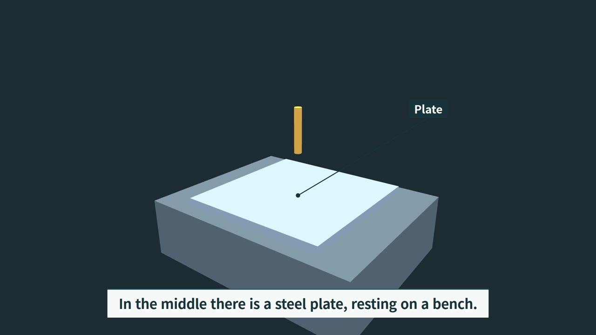

# rv: 대본으로 만드는 나레이션 3D 설명 영상

[English](README.md)

rv 는 대본(JSON)과 three.js 장면 모듈 몇 개로 나레이션이 붙은 완성 영상을 만들고, 결과를 프레임 단위로 검사한다.



*이 저장소의 바로 쓰는 예시 `examples/hello` 로 rv 가 만든 영상의 한 프레임.*

장면은 모두 시간의 순수 함수라 어느 프레임이든 똑같이 다시 그릴 수 있다. `rv make` 한 번으로 낱말 시각이 붙은 나레이션, 헤드리스 Chromium 으로 그린 모든 프레임, H.264 + AAC, 자막, 썸네일, 검사별 시간표, 자동 검사 보고서가 나온다.

## 빠른 시작

릴리스 태그에서 한 줄로 설치:

```
curl -fsSL https://raw.githubusercontent.com/orientpine/rv-video-tool/v0.1.0/scripts/install.sh | bash -s -- https://github.com/orientpine/rv-video-tool v0.1.0 ~/.local/share/rv-video-tool
```

`rv` 를 PATH 에 넣는다. 예: `ln -s ~/.local/share/rv-video-tool/rv ~/.local/bin/rv`. 아니면 `bash <폴더>/rv` 로 부른다.

바로 쓰는 예시로 첫 영상 만들기. 빌드 파일이 설치 폴더 안에 생기지 않게 먼저 복사한다:

```
cp -r ~/.local/share/rv-video-tool/examples/hello my-first
rv make my-first
```

ARM64 Linux 워크스테이션(20 코어, 내장 NVIDIA GPU)에서 음성 캐시가 빈 상태로 93 초짜리 1080p30 영상이 처음부터 끝까지 **224 초** 걸렸다. 그중 약 32 초가 검사다. `CHECKS.md` 는 `RV_CHECKS PASS` 로 끝난다. 다음 빌드부터는 바뀐 장면만 다시 그린다.

결과는 `my-first/out/` 에 생긴다:

| 파일 | 내용 |
|---|---|
| `hello.mp4` | 영상 (1080p30 H.264 High + AAC 48 kHz, -16 LUFS) |
| `hello.srt` | 자막 |
| `hello_thumb.jpg` | 썸네일 (`thumb_t` 시각, 기본 1.5 초) |
| `CHECKS.md` | 검사 보고서. 마지막 줄이 `RV_CHECKS PASS` 또는 `RV_CHECKS FAIL` |
| `CHECKS.timing.tsv` | 검사 단계마다 걸린 초 |
| `sheets/` | 키워드·장면 경계 둘레의 접촉 시트 |

작업 파일(음성 캐시, `timeline.json`, `video.html`, 프레임)은 `my-first/build/` 에 남는다.

## 에이전트에게 맡기기

동료에게 일을 맡기듯 코딩 에이전트(Claude Code, Codex 등)에게 통째로 맡길 수 있다. 이 레포를 clone 하고, 그 폴더에서 에이전트를 열고, 한 줄을 붙여 넣는다. 에이전트는 [AGENTS.md](AGENTS.md) 를 읽는다. 거기에 준비, `examples/hello` 에서 시작하기, 빌드, `CHECKS.md` 읽기, 검사가 아니라 장면을 고치기, 언제 멈추고 물을지가 적혀 있다. 에이전트는 `RV_CHECKS PASS` 까지 일하고 영상 위치를 알려 준다.

```
script.md 대본과 notes/ 자료로 3분짜리 설명 영상 만들어. rv check 다 통과할 때까지 해.
```
```
examples/hello 에서 시작해서 온도계가 어떻게 작동하는지 설명하는 짧은 영상 만들어. rv check 통과하면 끝.
```
```
projects/demo 영상 1분 20초쯤 뚜껑이 갑자기 튀어나와. 부드럽게 열리게 고치고 rv check 통과할 때까지 다시 빌드해.
```
```
projects/demo 검사가 느려. 검사 기준은 하나도 낮추지 말고 빠르게 해 줘.
```

에이전트는 `RV_CHECKS PASS`(strict 모드)로 끝내고 `out/<name>.mp4`·자막·썸네일 위치를 알려 준다. 영상은 직접 보고 판단한다. 검사는 결함을 잡을 뿐 취향까지 보지는 않는다. 에이전트가 묻는 것은 혼자 정할 수 없는 것뿐이다. 출처 없는 숫자, 서로 부딪치는 요청, 도구 버그, 이 컴퓨터 밖으로 나가는 일.

## 예제

예제는 `examples/hello` 같은 프로젝트 폴더다: `script.json`, `scenes/`, `shared/`. 연구 예제에는 숫자와 주장마다 공개 출처를 적은 `sources.json`, 배경음·효과음을 만드는 스크립트가 든 `audio/`, 한 줄 `README.md` 가 더 있다. 영상과 소리 파일은 git 에 넣지 않는다: KIMM 예제의 완성 영상과 자막은 이 예제가 처음 들어간 릴리스의 자산으로 올린다.

예제는 복사해서 빌드한다. `rv still` 은 몇 순간만 PNG 로 `<사본>/build/stills/` 에 그리고(1분 안팎, 영상 없음), `rv make` 는 영상 전체를 만들고 검사까지 돌린다. KIMM 예제는 소리를 섞는 `rv still`·`rv make` 전에 소리를 먼저 만든다: `rv tts` 가 내레이션과 시간표를 만들고, `audio/score.py` 가 그것을 읽어 `audio/*.wav` 를 쓴다(릴리스 영상에 쓴 것과 같은 파일).

```
cp -r ~/.local/share/rv-video-tool/examples/kimm-morphing-wheel my-wheel
rv tts my-wheel
uv run --no-project --with numpy python my-wheel/audio/score.py my-wheel
rv still my-wheel 20 44
rv make my-wheel
```

| 예제 | 길이 | 보여 주는 것 |
|---|---|---|
| `hello` | 93초 | 작업대·판·탐침 장면 셋: 카메라를 세운 채 바뀌는 자막, 탐침이 판에 닿을 때 다가가기, 낮은 각도. |
| `kimm-morphing-wheel` | 66.1초 | 한국기계연구원 모핑 휠: 건물 입구 18cm 턱에 멈춘 휠체어. 물방울 표면장력처럼 단단함이 바뀌는 바퀴(바퀴살 와이어가 체인 블록을 단단한 원으로 당기거나 말랑하게 풀어 줌)가 모서리를 감싸 오른다(작동 원리 재현). |
| `kimm-plasma-recycling` | 66.3초 | 한국기계연구원 사업단: 뒤섞인 폐플라스틱 산, 450~600℃ 열분해의 한계, 그리고 100% 수소 플라즈마가 0.01초 안에 플라스틱을 에틸렌·벤젠 원료로 분해한다. |
| `kimm-muscle-fabric` | 68.2초 | 한국기계연구원 근육옷감: 25㎛ 형상기억합금 코일실을 자동으로 짜 10g 옷감이 10~15kg을 들고, 840g 어깨 보조 로봇은 움직임 범위를 57% 이상 넓혀 부엌 선반에 컵을 다시 올린다. |

## 명령

```
rv make    <project> [--discord] [--from A --to B] [--jobs N] [--full] [--no-heavy]
rv preview <project> [--fps 15] [--jobs N]
rv board   <project> [scene,scene]
rv tts     <project>
rv still   <project> 3.8 16.2
rv scrub   <project> 18.0 19.5
rv check   <project>
rv discord <project> [--min-kbps 1200]
```

- `make` 는 전부 만들고 검사까지 돌린다. 바뀐 장면의 프레임만 다시 찍는다. `--full` 은 전부 다시, `--from/--to` 는 초 단위 구간만, `--discord` 는 용량 제한 공유판도 만든다.
- `preview` 는 빠른 초안: 후처리 끔, 15 fps, 960 px, 검사 없음, `out/<name>_preview.mp4`.
- `board` 는 장면마다 콘티 한 장(시작, 키워드 순간, 끝)을 `out/board/` 에 쓴다.
- `still` 은 몇 순간의 PNG 를 `build/stills/` 에, `scrub` 은 A~B 초를 0.2 초 간격 PNG 로 저장한다.
- `check` 는 이미 만든 mp4 에 검사만 다시 돌린다. `discord` 는 공유판만 다시 만들고(파일당 최대 20 MiB, 한 파일이면 비트레이트 바닥 아래로 떨어질 때 장면 경계에서 나눔) 검사한다. 원본이 이미 들어가면(통째로, 또는 키프레임에서 잘라 조각마다 20 MiB 이하·바닥 이상) 다시 인코딩하지 않고 복사해서 공유판 그림이 원본과 같다.

### 브라우저 몇 개

`rv make`·`rv preview`·`rv check` 는 브라우저 수를 머신에 맞춘다: CPU 코어 하나에 브라우저 하나, 시작할 때 남은 메모리의 4분의 3 에 1.5 GiB 씩 들어가는 만큼(`lib/workers.py`; `python3 lib/workers.py explain` 이 숫자를 찍음). 프레임 찍기는 최대 12 개다. GPU 하나에서 그보다 많으면 더 빨라지지 않았다. 또 Python 프로세스 하나에 브라우저 넷씩 나눠 프레임이 한 프로세스 뒤에 줄 서지 않게 한다. 검사는 샤드까지 합쳐 브라우저를 한 번에 12 개까지만 연다(여기서는 검사 6, 오래 걸리는 `check_clearance`·`check_layout` 본 검사는 각각 브라우저 4 개, `RV_CHECK_SHARDS`). 검사 20·샤드 6 에서는 3분짜리 3D 프로젝트의 한 페이지가 셰이더를 못 만들었고 검사도 더 빨라지지 않았다. `--jobs N`·`RV_CHECK_JOBS`·`RV_CHECK_SHARDS` 로 손으로 정할 수 있고, `RV_CORES`·`RV_MEM_GIB` 는 잰 값 대신 쓴다(다른 일 몫을 남길 때). 프레임과 검사 결과는 이 수와 상관없다. 장면 중간에서 시작하는 찍기 일꾼은 먼저 그 장면 처음부터 찍지 않고 그려 두고 찍어서, 어떻게 나눠도 모든 프레임이 한 번에 이어 찍은 것과 같다(예전에는 장면 앞쪽에서 페이드인한 글자가 일꾼 시작점에 따라 안티에일리어싱이 달라질 수 있었다).

프로젝트 폴더에는 `script.json`(목소리, 문장, 장면), `scenes/<이름>/module.js`, 선택으로 `deps.json`, `shared/`, `sources.json` 이 들어간다. 전체 안내: [HOWTO.md](HOWTO.md).

## 장면 키트 맛보기

`examples/text-motion` 은 장면 하나를 두 가지로 보여 준다(`scenes/device/mode.json`): `still` 은 카드가 떠 있는 동안 기기가 서 있어 `TEXT_MOTION` 이 잡고, `kit` 은 `KIT.shot.free`·`KIT.fx.pulse`·`KIT.process.spin`·흐르는 `KIT.process.exhaust` 길·`KIT.info.picture` 하나로 글자 옆에서 기기가 계속 일한다(HOWTO 4-2).

`examples/hello` 는 작은 무대 하나(`shared/bench.js`: 작업대, 판, 탐침)를 같이 쓰는 장면 셋이다. `bench` 는 자막이 바뀌는 동안 카메라를 세워 두고, `probe` 는 탐침이 판에 닿을 때 다가가고, `slide` 는 낮은 각도에서 탐침이 움직이는 것을 보여 준다. 장면 사이는 dip 전환으로 잇고, 밑에는 조용한 합성 배경음이 깔린다.

`script.json` 에서 중요한 부분:

```json
{
  "name": "hello", "voice": "en-US-AriaNeural", "checks": "strict", "site": "lab",
  "lead_s": 0.5, "tail_s": 1.0, "intro_s": 0.5,
  "scenes": [
    {"name": "bench", "extra_s": 3},
    {"name": "probe", "extra_s": 3, "transition": {"type": "dip", "dur": 1.2, "depth": 0.85}},
    {"name": "slide", "extra_s": 16, "transition": {"type": "dip", "dur": 1.2, "depth": 0.85}}
  ],
  "lines": [
    {"scene": "probe", "text": "Now the probe touches the plate.", "keywords": ["touches"]}
  ],
  "sound": {"music": "synth:ambient"}
}
```

`intro_s` 는 꼭 둔다. 첫 문장이 0 초 앞으로 밀리지 않게 자리를 준다.

장면 모듈은 `SCENES` 에 자기를 등록한다. rv 는 `init(renderer, THREE, overlay)` 를 한 번, `render(t)` 를 프레임마다 부른다(`t` 는 장면 시작부터의 초). `KIT`(`kit/scene_kit.js`)는 미리 실려 있다. 아래는 `scenes/probe/module.js` 그대로다:

```js
SCENES.probe = (() => {
  const NAME = "probe";
  let renderer, set, cam, tag, zoom;
  const start = {p: [3, 2.2, 4], l: [0, 0.4, 0], fov: 45};
  return {
    duration: DATA.timeline.modules[NAME].duration,
    init(r, THREE, overlay) {
      renderer = r;
      set = BENCH(THREE);
      cam = new THREE.PerspectiveCamera(45, 16 / 9, 0.1, 100);
      tag = KIT.label(overlay, "Probe", {target: set.probe, color: "#F2C14E", ink: "#16323C"});
      const hit = KIT.wordT(NAME, "touches");
      set.probe.position.set(0, 0.35, 0);   // pose at the end of the zoom
      zoom = KIT.shot.action(NAME, {t: hit - 1, dur: 2, from: start, at: set.probe, keep: [set.probe]});
    },
    render(t) {
      const hit = KIT.wordT(NAME, "touches");
      window.HL = t >= hit && t < hit + 1.5 ? "touches" : "";
      set.probe.position.y = 0.9 - 0.55 * KIT.smooth(hit - 1, hit, t);
      KIT.camSet(cam, zoom.at(t));
      tag.place(cam, set.probe.position, -40, -120, t >= hit && t < hit + 2 ? 1 : 0);
      renderer.render(set.scene, cam);
    }
  };
})();
```

부품이 하는 일:

- `KIT.wordT(NAME, "touches")` 는 나레이터가 그 낱말을 말하는 시각(장면 기준 초). 움직임을 손으로 적은 숫자 말고 말에 묶는다. `window.HL` 은 지금 강조 중인 키워드를 키워드 검사에 알려 준다.
- `KIT.shot.action(NAME, {t, dur, from, at, keep, avoid})` 는 동작 순간 줌. `keep` 이 모두 안전 영역 안에 남는 가장 가까운 구도를 찾고, 장면 전환이 끝난 뒤 시작하고, 샷을 3 초 이하로 자르고, `kind: "action"` 으로 선언한다. 그래서 자막이나 이름표가 뜨는 순간에도 카메라가 움직여도 된다. `zoom.at(t)` 가 카메라 상태를 주고, 맞는 구도가 없으면 `zoom.fits` 가 false. 위 실행에서는 `CAMERA_UI_EXEMPT ... kind=action subject='probe'` 로 찍혔다.
- `KIT.camSet(cam, {p, l, fov})` 는 카메라를 놓는다. `bench` 와 `slide` 장면은 고정 값으로 부른다. 가장 자주 쓸 또 하나의 샷, 글자가 바뀌는 동안 세워 둔 카메라다.
- `KIT.label(overlay, text, {target})` 는 이름표를 달고, `place(cam, point, dx, dy, alpha)` 로 프레임마다 자리를 잡는다. 예시는 이름표를 서서히 나타내지 않고 켜고 끈다. 그래야 대비 검사가 반쯤 투명한 이름표를 재지 않는다.
- 그 밖에: `KIT.shot.track(NAME, {t, dur, subject})` 는 이름 있는 움직이는 물체를 따라가고, `KIT.shot.declare(NAME, [{t, end, kind, subject}])` 는 샷을 손으로 선언하고(`"action"`, `"ui-only"`), `KIT.shot.establish / pushIn / orbit` 은 `KIT.camAt` 에 줄 열쇠를 만든다. 투시, 분해, 사람, 공정 단계, 숫자 카드는 [HOWTO.md](HOWTO.md) 4절.
- 실제 영상은 `examples/story` 에서 시작한다: 네 박자(`scenes[].beat`: problem 문제 장면, inside 기술 속, result 결과 순간, after 바뀐 모습), 장면마다 장소(`scenes[].place` + `KIT.place(NAME, scene)`: 보도·공장·재활용장·진료실·부엌·연구실, 깊이·빛·공기·배경 움직임까지 모두 절차 생성), `KIT.fx.human` 사람, 숫자 카드(`KIT.info.numCard`: 기본은 주인공 옆 빈 자리, 읽히는 크기 80·36·24 px).

## `rv check` 가 잡는 것

검사기마다 일부러 망가뜨린 판(변이)으로 한 번 더 돌고, 검사기가 스스로 `MUTATION_CAUGHT` 를 말해야 한다. 그래서 조용히 일을 멈춘 검사기는 실패로 드러난다. 검사기가 죽거나 페이지가 WebGL 컨텍스트를 잃으면 통과가 아니라 `CHECK_ERROR` 나 `PAGE_ERROR` 다.

시간은 위 실행(93 초 영상)의 `out/CHECKS.timing.tsv` 에 적힌 실제 초이고, 검사기마다 변이 실행을 포함한다. 검사는 동시에 돈다(`RV_CHECK_JOBS` 개까지. 오래 걸리는 `check_clearance`·`check_layout` 본 검사는 프레임을 브라우저 `RV_CHECK_SHARDS` 개에 나눠 잼. 둘 다 기본값은 이 머신의 코어·남은 메모리로 정함, 아래 "브라우저 몇 개" 참고). 그래서 줄을 더하면 전체보다 크다(검사기 시간 266 초가 32 초 안에 돎, 예전 고정값 검사기 6·샤드 4 로 잰 것). "건너뜀"은 예시에 잴 대상이 없다는 뜻이고, 이때는 변이 실행만 시간이 들었다.

| 무엇 | 검사기 | `examples/hello` 에서 걸린 시간 |
|---|---|---:|
| 검은 프레임, 프레임 사이 밝기 급변 | `check_cuts` | 38.1 s |
| 한두 프레임 튀었다 돌아오기 (8x8 칸, 원본과 공유판) | `check_flicker` | 7.4 s |
| 나레이션 키워드와 화면 강조 (0.5 초 안) | `sync_check` | 3.0 s |
| 자막 조각이 충분히 보이는지 (0.4 초 이상) | `check_captions` | < 0.1 s |
| 글자 겹침, 잘림, 대비, 안전 영역, 설명 대상 가림 | `check_layout` | 33.2 s |
| 테마 유지 시간, 전환 밝기, 흰 화면 반복, 눈의 피로 | `check_cuts --theme` | 48.8 s |
| 글자가 바뀔 때나 전환 중 카메라 이동, 순간이동, 관통 | `check_motion` | 28.0 s (`check_motion` 줄 전체) |
| 전환과 글자 (`TEXT_TRANSITION`): 전환이 시작될 때 보이는 글자, 전환 안에서 새로 뜨는 글자, 전환 직전에 너무 잠깐 떠서 못 읽는 글자 | `check_motion` | 28.0 s 안 |
| 말과 동작 (`ACTION_MATCH`): 말한 동작 낱말마다 그 낱말이 가리키는 이름 있는 부품에 묶이고, 그 부품이 말대로 움직이는지 | `check_motion` | 28.0 s 안 (예시에 동작 낱말 없음) |
| 문·뚜껑 (`HATCH_COVER`): 닫힌 해치가 틀 구멍을 80% 이상 덮는지 | `check_motion` | 28.0 s 안 (예시에 해치 없음) |
| 갑자기 등장 (`POP_IN`): 카드·이름표·부품이 서서히 나타나기·밀려 들어오기·카메라가 비춰 드러내기 없이 한두 프레임에 나타나는지 | `check_motion` | `check_motion` 시간 안 |
| 설명 대상 화면 가운데 (`SUBJECT_FRAME`): 동작을 말하는 동안 그 말이 가리키는 부품이 화면 가운데 30% 안에 오는지 | `check_motion` | `check_motion` 시간 안 (예시에 동작 낱말 없음) |
| 글자 옆 움직임 (`TEXT_MOTION`): 카드·이름표·자막이 떠 있고 카메라가 서 있는 동안 글자가 가리지 않은 3D 화면이 2 s 이상 멈춰 있지 않은지. 선언한 `ui-only` 멈춤과 풍부한 정지 그림은 의도로 봄 | `check_motion` | `check_motion` 시간 안 |
| 정지 그림 (`PICTURE`): `KIT.info.picture` 가 3 s 이상 다 보이고, 화면 8% 이상이고, 풍부한지(빈 판·글자만 아님) | `check_motion` | `check_motion` 시간 안 (`examples/hello` 에 그림 없음) |
| 부품이 지지대에 파묻히거나 떨어짐, 이름표 단 부품이 떠 있음, 기계끼리 충돌, 앉은 자세 접촉 | `check_clearance` | 34.5 s |
| 사람: `KIT.fx.human` 만, 몸 부위, 접촉점, 복식이 현장과 맞는지 | `check_human` | 16.1 s (건너뜀, 변이는 돎) |
| `sources.json` 에 출처 없는 화면·나레이션 숫자 | `check_numbers` | 14.3 s (건너뜀, `sources.json` 없음) |
| 심도, 모션 블러, 공유판 인코딩 뒤 주인공 선명도 | `check_sharp` | 15.5 s (건너뜀, `look` 없음) |
| 앙상한 영상: 빈 배경, 화면에 물체가 너무 적음, 사람 없음, 카드가 너무 큼, 이야기 박자·장소 없음, 부품 뒤에 가린 3D 글자, 납작한 판 연기·반투명 판 단면 (`QUALITY_*`, 예외는 이유를 적어야) | `check_quality` | QUALITY_TIME |
| SRT 큐 수, 접촉 시트 | `sheet` | 5.7 s |
| **`rv check` 전체** (첫 단계 시작부터 마지막 단계 끝까지) | | **32.0 s** |

새 검사들(글자 배치, 테마, 음량, 사람, 움직임, 숫자, 선명도, 메시 간극)은 `script.json` 에 `"checks": "strict"` 가 있을 때만 판정을 실패로 만든다. 아니면 적기만 하고 `RV_CHECKS_REFERENCE_FAILS` 로 센다. 새 프로젝트는 `"checks": "strict"` 로 시작한다.

예시가 통과하려고 맞춰야 했던 것, 직접 만들 때도 만난다:

- dip 이 시작될 때 화면에 자막이 없어야 하고, 그 직전 자막은 읽을 시간이 있어야 한다. 장면을 짧은 문장으로 끝내고 `extra_s` 를 몇 초 둔다.
- 나레이션 틈이 2.5 초를 넘으면 말 사이 무음으로 잡힌다. 배경음(`"sound"`)이 장면 끝 여백 동안 소리가 끊기지 않게 한다.
- 이름표는 단색 배경 위에 두고 켜고 끈다. 그래야 대비가 완전히 보이는 상태로 재진다.

## 필요한 것

- **OS**: Linux. 설치 스크립트와 `rv` 는 bash 와 Python 뿐이라 macOS 에서도 돌 것으로 보지만 이번 릴리스에서 확인하지 않았다.
- **Python** 3.10+ 와 [uv](https://docs.astral.sh/uv/). rv 는 playwright, pillow, numpy, edge-tts 를 `uv run --with` 로 가져오므로 가상환경을 따로 만들 필요가 없다.
- PATH 에 **ffmpeg 와 ffprobe**.
- **브라우저**: 헤드리스 렌더링용 Chromium. `uv run --with playwright playwright install chromium` 으로 받거나, `RV_CHROME` 에 있는 Chromium 을 지정한다.
- **GPU**: 있으면 쓴다. 위 기계에서 Chromium 은 `ANGLE (NVIDIA ... OpenGL ES 3.2)` 로 그렸다. GPU 없이 Chromium 이 소프트웨어 렌더링으로 내려가는 경우는 아직 확인하지 않았다.
- **네트워크**: 나레이션은 edge-tts 를 쓰고, 문장을 처음 읽을 때 네트워크가 필요하다. 결과는 캐시되므로 같은 대본의 다음 빌드는 오프라인으로 돈다. `rv tts <project>` 는 음성과 시간표만 만들므로, 네트워크 되는 PC 에서 먼저 돌리고 렌더는 다른 PC 에서 해도 된다.

## 설치 확인

설치 폴더에는 태그의 파일과 `VERSION` 만 들어 있다. 다시 설치하면 옛 사본을 옆에 남긴다(`<폴더>.bak-<시각>`). 설치가 태그와 같은지 보려면 `bash scripts/verify.sh <폴더>` 를 돌린다. `RV_TREE <sha256> <파일 수>` 한 줄이 나오고, 태그의 파일(`git archive v0.1.0 | tar -x -C <dir>`)에 같은 명령을 돌린 결과와 같아야 한다.

## 테스트

```
bash scripts/test.sh                 # 전체 테스트. 처음 나레이션 캐시를 채운 뒤엔 오프라인
bash scripts/test.sh check_error     # 이름을 준 테스트만
```

테스트는 녹음된 나레이션이 든 합성 픽스처 `tests/project` 에서 돈다. 테스트용으로 `tests/prepare_project.py` 가 빌드하며 `rv make` 용이 아니다. `rv make` 는 `examples/hello` 로 해 본다.

## 릴리스와 변경

[RELEASES.md](RELEASES.md) 와 GitHub 릴리스 페이지에 태그마다 바뀐 것이 한국어와 영어로 있다. 고친 것이 풀 리퀘스트에서 설치까지 가는 길: [MAINTAINING.md](MAINTAINING.md).

## 라이선스

MIT ([LICENSE](LICENSE)). 함께 든 three.js 파일도 MIT ([THIRD_PARTY.md](THIRD_PARTY.md)).
