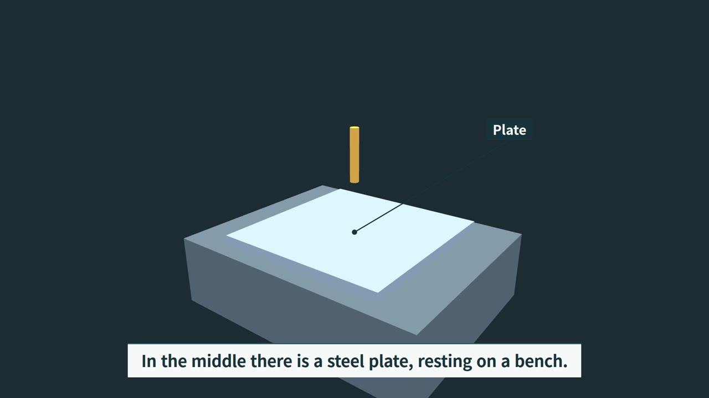

# rv: narrated 3D explainer videos from a script

[한국어](README.ko.md)

rv turns a script (JSON) and a few three.js scene modules into a finished, narrated video, then checks the result frame by frame.



*One frame of the video rv made from `examples/hello`, the ready example in this repo.*

Every scene is a pure function of time, so any frame can be redrawn exactly. One `rv make` gives you narration with word timings, every frame rendered in headless Chromium, H.264 + AAC, subtitles, a thumbnail, a per-check timing table and a report of automatic checks.

## Quick start

Install from a release tag (one line):

```
curl -fsSL https://raw.githubusercontent.com/orientpine/rv-video-tool/v0.1.0/scripts/install.sh | bash -s -- https://github.com/orientpine/rv-video-tool v0.1.0 ~/.local/share/rv-video-tool
```

Put `rv` on your PATH, for example `ln -s ~/.local/share/rv-video-tool/rv ~/.local/bin/rv`, or call it as `bash <folder>/rv`.

Make a first video from the ready example. Copy it first, so the build files don't land inside the install folder:

```
cp -r ~/.local/share/rv-video-tool/examples/hello my-first
rv make my-first
```

On an ARM64 Linux workstation (20 cores, integrated NVIDIA GPU) this took **224 s** end to end for a 93 s, 1080p30 video, starting from an empty speech cache. About 32 s of that is the check run. Its `CHECKS.md` ends in `RV_CHECKS PASS`. Later builds only redraw scenes that changed.

The outputs land in `my-first/out/`:

| File | What it is |
|---|---|
| `hello.mp4` | the video (1080p30 H.264 High + AAC 48 kHz, -16 LUFS) |
| `hello.srt` | subtitles |
| `hello_thumb.jpg` | thumbnail (frame at `thumb_t`, default 1.5 s) |
| `CHECKS.md` | the check report; the last line is `RV_CHECKS PASS` or `RV_CHECKS FAIL` |
| `CHECKS.timing.tsv` | seconds spent on each check step |
| `sheets/` | contact sheets around keywords and scene borders |

Working files (speech cache, `timeline.json`, `video.html`, frames) go to `my-first/build/`.

## Commands

```
rv make    <project> [--discord] [--from A --to B] [--jobs N] [--full] [--no-heavy]
rv preview <project> [--fps 15] [--jobs N]
rv board   <project> [scene,scene]
rv still   <project> 3.8 16.2
rv scrub   <project> 18.0 19.5
rv check   <project>
rv discord <project> [--min-kbps 1200]
```

- `make` builds everything and runs the checks. It only re-captures frames of scenes that changed; `--full` redraws all, `--from/--to` limits the range in seconds, `--discord` also writes the size-capped share copy.
- `preview` is a fast draft: post effects off, 15 fps, 960 px, no checks, written to `out/<name>_preview.mp4`.
- `board` writes one storyboard sheet per scene (start, keyword moments, end) to `out/board/`.
- `still` saves PNGs of single moments to `build/stills/`, `scrub` saves PNGs every 0.2 s between A and B.
- `check` reruns the checks on the existing mp4. `discord` rebuilds only the share copy (at most 20 MiB per file, split at scene borders when one file would drop below the bitrate floor) and then checks. When the original already fits (whole, or cut at key frames into parts of at most 20 MiB that keep the bitrate floor), it is copied without encoding again, so the share copy has the original picture.

### How many browsers

`rv make`, `rv preview` and `rv check` size their browser counts to the machine: one browser per CPU core, as many as three quarters of the memory free at the start holds at 1.5 GiB each (`lib/workers.py`; `python3 lib/workers.py explain` prints the numbers). Frame capture uses at most 12, because on one GPU more browsers stopped helping, and runs four browsers per Python process so the frames do not queue behind one process. The long `check_clearance` and `check_layout` real runs each share their frames over a third of the browsers (`RV_CHECK_SHARDS`). `--jobs N`, `RV_CHECK_JOBS` and `RV_CHECK_SHARDS` still set them by hand; `RV_CORES` and `RV_MEM_GIB` replace the detected values (to leave room for other work). Frames and check results do not depend on these counts.

A project folder holds `script.json` (voice, lines, scenes), `scenes/<name>/module.js`, optional `deps.json`, `shared/` and `sources.json`. Full guide: [HOWTO.md](HOWTO.md).

## Scene kit in short

`examples/hello` has three scenes that share one small set (`shared/bench.js`: a bench, a plate and a probe). `bench` keeps the camera still while captions change, `probe` zooms in as the probe touches the plate, and `slide` shows the probe moving from a lower angle. Scenes are joined by a dip transition, and a quiet synthesized music bed runs underneath.

The parts of `script.json` that matter:

```json
{
  "name": "hello", "voice": "en-US-AriaNeural", "checks": "strict", "site": "lab",
  "lead_s": 0.5, "tail_s": 1.0, "intro_s": 0.5,
  "scenes": [
    {"name": "bench", "extra_s": 3},
    {"name": "probe", "extra_s": 3, "transition": {"type": "dip", "dur": 1.2, "depth": 0.85}},
    {"name": "slide", "extra_s": 16, "transition": {"type": "dip", "dur": 1.2, "depth": 0.85}}
  ],
  "lines": [
    {"scene": "probe", "text": "Now the probe touches the plate.", "keywords": ["touches"]}
  ],
  "sound": {"music": "synth:ambient"}
}
```

Keep `intro_s` set: it gives the first line room before 0 s.

A scene module registers itself in `SCENES`. rv calls `init(renderer, THREE, overlay)` once and `render(t)` for every frame, with `t` in seconds from the scene start. `KIT` (from `kit/scene_kit.js`) is loaded for you. This is `scenes/probe/module.js`:

```js
SCENES.probe = (() => {
  const NAME = "probe";
  let renderer, set, cam, tag, zoom;
  const start = {p: [3, 2.2, 4], l: [0, 0.4, 0], fov: 45};
  return {
    duration: DATA.timeline.modules[NAME].duration,
    init(r, THREE, overlay) {
      renderer = r;
      set = BENCH(THREE);
      cam = new THREE.PerspectiveCamera(45, 16 / 9, 0.1, 100);
      tag = KIT.label(overlay, "Probe", {target: set.probe, color: "#F2C14E", ink: "#16323C"});
      const hit = KIT.wordT(NAME, "touches");
      set.probe.position.set(0, 0.35, 0);   // pose at the end of the zoom
      zoom = KIT.shot.action(NAME, {t: hit - 1, dur: 2, from: start, at: set.probe, keep: [set.probe]});
    },
    render(t) {
      const hit = KIT.wordT(NAME, "touches");
      window.HL = t >= hit && t < hit + 1.5 ? "touches" : "";
      set.probe.position.y = 0.9 - 0.55 * KIT.smooth(hit - 1, hit, t);
      KIT.camSet(cam, zoom.at(t));
      tag.place(cam, set.probe.position, -40, -120, t >= hit && t < hit + 2 ? 1 : 0);
      renderer.render(set.scene, cam);
    }
  };
})();
```

What the parts do:

- `KIT.wordT(NAME, "touches")` is the time (in scene seconds) the narrator says that word. Tie motion to words, not to hand-typed numbers. `window.HL` tells the keyword check what's highlighted right now.
- `KIT.shot.action(NAME, {t, dur, from, at, keep, avoid})` is the action zoom. It finds the closest framing that keeps everything in `keep` inside the safe area, starts after any scene transition, caps the shot at 3 s and declares it as `kind: "action"`, so the camera may move while a caption or label appears. `zoom.at(t)` returns the camera state, `zoom.fits` is false if no framing worked. The run above logged it as `CAMERA_UI_EXEMPT ... kind=action subject='probe'`.
- `KIT.camSet(cam, {p, l, fov})` places the camera. The `bench` and `slide` scenes call it with a fixed state, which is the other shot you'll use most: a still camera while text changes.
- `KIT.label(overlay, text, {target})` adds a name tag; `place(cam, point, dx, dy, alpha)` positions it each frame. The example switches labels on and off instead of fading them, so the contrast check never samples a half-faded tag.
- Also available: `KIT.shot.track(NAME, {t, dur, subject})` follows a named moving object, `KIT.shot.declare(NAME, [{t, end, kind, subject}])` declares shots by hand (`"action"`, `"ui-only"`), and `KIT.shot.establish / pushIn / orbit` build keyframes for `KIT.camAt`. Cutaways, exploded views, people, process steps and numbered cards are in [HOWTO.md](HOWTO.md) section 4.

## What `rv check` catches

Each checker also runs on a deliberately broken copy (a mutation) and must report `MUTATION_CAUGHT`, so a checker that quietly stops working shows up as a failure. A checker that crashes, or a page that loses its WebGL context, counts as `CHECK_ERROR` or `PAGE_ERROR`, never as a pass.

Times are wall-clock seconds from `out/CHECKS.timing.tsv` of the run above (93 s video), including each checker's mutation runs. Checks run in parallel (up to `RV_CHECK_JOBS`; the long `check_clearance` and `check_layout` real runs also share their frames over `RV_CHECK_SHARDS` browsers; both default to what this machine's cores and free memory hold, see "How many browsers" below), so the rows add up to more than the total (266 s of checker time in 32 s). "Skipped" means the example has nothing for that checker to measure, so only its mutation runs took time.

| What | Checker | Time on `examples/hello` |
|---|---|---:|
| Black frames and sudden brightness jumps between frames | `check_cuts` | 38.1 s |
| One- or two-frame flicker (8x8 grid, original and share copy) | `check_flicker` | 7.4 s |
| Narration keyword vs on-screen highlight (within 0.5 s) | `sync_check` | 3.0 s |
| Caption pieces visible long enough (at least 0.4 s) | `check_captions` | < 0.1 s |
| Text overlap, clipping, contrast, safe area; occlusion of the explained object | `check_layout` | 33.2 s |
| Theme length, transition brightness, white-screen repeats, eye fatigue | `check_cuts --theme` | 48.8 s |
| Camera moving while text changes or during a transition; teleports and penetration | `check_motion` | 28.0 s (all `check_motion` rows) |
| Text across transitions (`TEXT_TRANSITION`): text visible when a transition starts, new text inside one, or text shown too briefly before one to be read | `check_motion` | in the 28.0 s |
| Speech to animation (`ACTION_MATCH`): each spoken action word is tied to the named part it talks about, and that part moves the way the words say | `check_motion` | in the 28.0 s (no action words in the example) |
| Doors and lids (`HATCH_COVER`): a closed hatch covers at least 80% of its frame opening | `check_motion` | in the 28.0 s (no hatch in the example) |
| Pop-in (`POP_IN`): a card, label or 3D part that appears in one or two frames with no fade, slide or camera reveal | `check_motion` | in the `check_motion` time |
| Explained part near the centre (`SUBJECT_FRAME`): during each spoken action the part it names stays in the middle 30% of the frame | `check_motion` | in the `check_motion` time (no action words in the example) |
| Parts buried in or detached from their mounts, labelled parts floating, machine collisions, seated contact | `check_clearance` | 34.5 s |
| People: only `KIT.fx.human` figures, body parts, contacts, outfit matches the site | `check_human` | 16.1 s (skipped, mutations ran) |
| Numbers on screen or in narration without a source in `sources.json` | `check_numbers` | 14.3 s (skipped, no `sources.json`) |
| Subject sharpness after depth of field, motion blur and share-copy encoding | `check_sharp` | 15.5 s (skipped, no `look`) |
| Loudness and clipping, silence inside speech; music and effects audible but under the voice | `check_audio` | 21.0 s |
| SRT cue count and contact sheets | `sheet` | 5.7 s |
| **Total `rv check`** (first step start to last step end) | | **32.0 s** |

The newer checks (layout, theme, audio, people, motion, numbers, sharpness, mesh clearance) only fail the run when `script.json` has `"checks": "strict"`. Otherwise they're reported and counted in `RV_CHECKS_REFERENCE_FAILS`. Start new projects with `"checks": "strict"`.

Things the example had to get right to pass, which you'll meet too:

- No caption should be on screen when a dip starts, and the last caption before it needs time to be read. End each scene with a short line and a few seconds of `extra_s`.
- Narration gaps over 2.5 s count as silence inside speech. A music bed (`"sound"`) keeps the track from going silent during those scene tails.
- Keep labels over a plain background and switch them on and off, so their contrast is measured at full opacity.

## Requirements

- **OS**: Linux. The install script and `rv` are plain bash plus Python; macOS is meant to work but hasn't been verified for this release.
- **Python** 3.10+ and [uv](https://docs.astral.sh/uv/). rv pulls playwright, pillow, numpy and edge-tts through `uv run --with`, so there's no virtualenv to set up.
- **ffmpeg and ffprobe** on PATH.
- **Browser**: a Chromium for headless rendering. Either `uv run --with playwright playwright install chromium`, or point `RV_CHROME` at an existing Chromium.
- **GPU**: used when present. On the machine above Chromium rendered through `ANGLE (NVIDIA ... OpenGL ES 3.2)`. Running without a GPU, where Chromium would fall back to software rendering, is not yet verified.
- **Network**: narration uses edge-tts, which needs network the first time a line is spoken. Results are cached, so later builds of the same script run offline.

## Verify an install

The install folder holds exactly the files of the tag plus `VERSION`. Installing again keeps the old copy beside it (`<folder>.bak-<time>`). To check an install against a tag, run `bash scripts/verify.sh <folder>`. It prints one `RV_TREE <sha256> <file count>` line, and the same command on the tag's files (`git archive v0.1.0 | tar -x -C <dir>`) must print the same line.

## Tests

```
bash scripts/test.sh                 # every test, offline after the first narration cache fill
bash scripts/test.sh check_error     # only the named tests
```

The tests run on `tests/project`, a synthetic fixture with recorded narration. It's built by `tests/prepare_project.py` for the test suite and isn't meant for `rv make`; use `examples/hello` for that.

## Releases and changes

[RELEASES.md](RELEASES.md) and the GitHub release page list what changed in each tag, in Korean and English. How fixes get from a pull request to an install: [MAINTAINING.md](MAINTAINING.md).

## License

MIT ([LICENSE](LICENSE)). Bundled three.js files are MIT ([THIRD_PARTY.md](THIRD_PARTY.md)).
